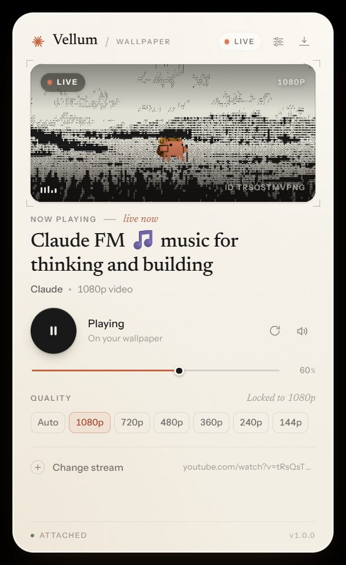

# Vellum

Vellum 把 YouTube 直播变成 Windows 桌面壁纸：视频贴在桌面图标下面，不占任务栏，不弹浏览器窗口，也不会出现 YouTube 的边栏、标题栏或鼠标悬停控件。配套的控制面板沿用了 Claude 的视觉语言——羊皮纸底色、衬线标题、赤陶色点缀。



## 功能

- 直播画面作为真正的桌面壁纸（挂在 Explorer 的 WorkerW 上，位于图标之后）
- 隐藏 YouTube 的全部界面：iframe 不接收鼠标事件，另有一层透明点击盾，鼠标怎么动都不会触发边栏或暂停按钮
- 暂停 / 继续、音量、静音、画质选择（Auto / 1080p / 720p … 实际档位来自直播源）
- 画质是真正锁定的：Auto 跟随源的最高档，选 1080p 就锁在 1080p；实现方式是在嵌入播放器内部调用 `setPlaybackQualityRange`，**不需要登录 YouTube**（详见下方“画质”一节）
- 控制面板：正在播放的标题、频道、当前画质、缩略图、直播状态、换流输入框
- 系统托盘菜单 + 全局快捷键
- 开机自启（可选）、无边框面板、关闭面板后壁纸继续播放
- 直播链接支持 `youtube.com/watch?v=…`、`youtu.be/…`、`youtube.com/@频道/live` 以及直接粘贴 11 位视频 ID

## 使用

### 直接运行（推荐）

1. 解压 `dist/Vellum` 文件夹到任意位置（例如 `D:\Apps\Vellum`）。
2. 双击 `Vellum.exe`（或 `Vellum.cmd`）。
3. 右下角出现 Vellum 面板，桌面壁纸开始播放默认的 Lofi Girl 直播。

若首次启动 Windows 弹出 SmartScreen 提示，选择“更多信息 → 仍要运行”即可（本地构建的可执行文件没有代码签名）。

### 从源码运行

```bash
npm install
npm start
```

打包便携版：

```bash
npm run package
```

产物在 `dist/Vellum/`。

## 操作

| 操作 | 方式 |
| --- | --- |
| 暂停 / 继续 | 面板大按钮；托盘菜单；`Ctrl+Alt+P` |
| 显示 / 隐藏面板 | 托盘菜单；`Ctrl+Alt+V`；面板右上角隐藏按钮；`Esc` 关闭弹层 |
| 切换画质 | 面板 QUALITY 一行；托盘 Quality 子菜单 |
| 静音 | 面板扬声器图标；托盘 Mute |
| 换直播 | 面板 “Change stream” 粘贴链接；托盘 “Change stream…” |
| 重新连接 | 面板刷新图标；托盘 Reconnect |
| 退出 | 托盘菜单 Quit |

## 说明与限制

- 只支持 Windows 10/11；壁纸窗口挂在 Explorer 的 WorkerW 上，Explorer 重启后 Vellum 会自动重新挂载。
- 当前版本只覆盖主显示器；多屏时副屏保持系统壁纸。
- 需要联网。部分直播（例如频道禁止嵌入）无法播放，面板会给出错误提示，换一个可嵌入的直播即可。
- 画质说明：面板里的档位会真正锁定到桌面画面上，不需要登录账号，也不会弹出浏览器。YouTube 公网 IFrame API 没有暴露 `setPlaybackQualityRange`，所以 Vellum 由主进程在跨域的嵌入框架里执行这段调用，并每 12 秒重新确认一次，避免直播中途被自适应算法降回 480p。
  - 面板显示 “Locked to 1080p” 表示已锁在该档位；如果直播源本身送不出这个档位，会显示 “Requesting 1080p · stream sends 480p”，这时桌面就是源的实际档位，换一条真的 1080p 直播即可。
- 播放看门狗：如果嵌入框架被浏览器丢弃、播放器不再响应或画面停止推进，Vellum 会自动重建播放器；连续失败时会提示“Reconnect”，不会一直停在 Tuning in。
- 声音来自壁纸窗口，正常跟随系统音量；如果只想看画面，点面板扬声器图标静音。
- 无边框面板是置顶窗口，拖动面板顶部区域可移动。

## 项目结构

```
src/main/        主进程：窗口、WorkerW 原生挂载（koffi）、直播解析、配置、托盘
src/preload/     contextBridge 桥接（panel / wallpaper 两套）
src/renderer/panel/     Claude 风格控制面板（原生 HTML/CSS/JS）
src/renderer/wallpaper/ 壁纸页：YouTube IFrame API + 无控件播放
assets/fonts/    Newsreader + Instrument Sans（SIL OFL）
docs/CONTRACT.md 主进程与渲染层之间的接口契约
scripts/package.js 便携版打包
```

## 调试

```powershell
$env:VELLUM_DEBUG_PORT='9222'
npm start
```

然后访问 `http://127.0.0.1:9222/json/list`（仅本地调试，正常启动不会开启）。

## 许可

MIT。字体为 SIL Open Font License，见 `assets/fonts/`。
